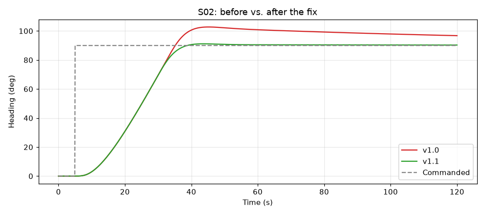
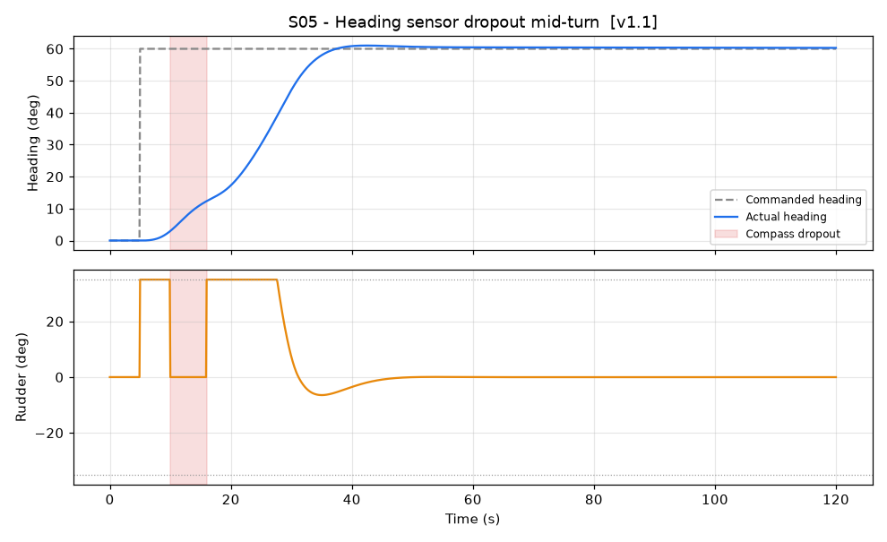

# Vessel Autopilot — Software-in-the-Loop (SIL) Verification

A test and verification framework for an autonomous vessel's heading and speed autopilot. The control software runs closed-loop against a simulated boat, with injected disturbances and sensor faults, and every requirement is verified automatically with a pass/fail result.

**Result:** the campaign caught two defects in software build v1.0 (integrator windup and missing sensor-fault handling). After root cause analysis and fixes, v1.1 passes **17/17** requirement checks.



---

## How SIL testing works

```
            ┌────────────────────── SIL harness (10 Hz) ──────────────────────┐
            │                                                                  │
 Scenario ─►│  Simulated sensors ─► AUTOPILOT (software under test) ─► commands │
 (faults,   │        ▲                                                  │      │
 setpoints, │        └──────────── Simulated vessel physics ◄────────────┘      │
 noise)     │                                                                  │
            └──────────────┬───────────────────────────────────────────────────┘
                           ▼
            Logged signals (SQLite) ─► Requirement checks ─► Pass/Fail report
```

The real autopilot code never knows it is talking to a simulation. That is the point: the same code can later run in hardware-in-the-loop (HIL) testing and on the boat.

| Component | File | What it does |
|---|---|---|
| Vessel model | `sil/vessel.py` | Nomoto steering dynamics, thrust vs. hull drag, rudder position/rate limits, current disturbance, compass noise and dropouts |
| Software under test | `sil/autopilot.py` | Heading PID + speed PI autopilot. Two builds: v1.0 (baseline) and v1.1 (fixed) |
| Test matrix | `sil/scenarios.py` | Six scenarios from nominal to sensor failure |
| Requirements | `sil/requirements.py` | Ten "shall" requirements, each with an automated metric and limit |
| Campaign runner | `run_campaign.py` | Runs everything, logs to SQLite, writes the traceability matrix, report, and plots |
| Regression suite | `tests/` | pytest: one test case per requirement × scenario |
| Dashboard | `app.py` | Streamlit test reporting + interactive test bench |
| FRACAS | `docs/fracas_log.md` | Failure reports, root cause, corrective action, verification |

---

## Requirements

| ID | Requirement | Verified by |
|---|---|---|
| REQ-HDG-001 | Settle within 2° of a commanded heading change within 45 s | S01, S02 |
| REQ-HDG-002 | Heading overshoot ≤ 10% of the commanded change | S01, S02 |
| REQ-HDG-003 | Steady-state heading error ≤ 1.0° under constant yaw disturbance | S03 |
| REQ-HDG-004 | RMS heading error ≤ 1.5° with 0.5° compass noise | S04 |
| REQ-ACT-001 | Rudder commands never exceed the ±35° mechanical limit | All |
| REQ-FLT-001 | Heading sensor loss flagged within 0.5 s | S05 |
| REQ-FLT-002 | No more than 15° past the commanded course during/after sensor loss | S05 |
| REQ-FLT-003 | Back within 2° of setpoint within 45 s after the sensor returns | S05 |
| REQ-SPD-001 | Reach within 0.5 kn of a 10 kn command within 60 s from rest | S06 |
| REQ-SPD-002 | Speed overshoot ≤ 5% | S06 |

## Test matrix

| ID | Scenario | Objective |
|---|---|---|
| S01 | Heading step 30° | Nominal course change |
| S02 | Heading step 90° | Large maneuver with rudder saturation |
| S03 | Heading hold, constant current | Disturbance rejection |
| S04 | Heading hold, noisy compass | Accuracy with sensor noise |
| S05 | 6 s compass dropout mid-turn | Fault detection, safe mode, recovery |
| S06 | Speed 0 → 10 kn | Speed control from rest |

## Results

| Build | Checks | Passed | Failed |
|---|---|---|---|
| v1.0 | 17 | 13 | 4 |
| v1.1 | 17 | **17** | 0 |

**Defects found in v1.0** (full details in `docs/fracas_log.md`):

1. **Integrator windup** (S02). While the rudder was saturated, the integral term kept growing, so the boat overshot by ~13° and was still ~8° off course two minutes later. *Fix:* freeze the integrator while saturated.
2. **Stale sensor data treated as valid** (S05). During the compass dropout, v1.0 reused the last heading without raising a fault and held full rudder. *Fix:* detect missing data, enter safe mode (rudder centered, integrator frozen), and flag the fault.



---

## Run it

```bash
python3 -m venv .venv && source .venv/bin/activate
pip install -r requirements.txt

python run_campaign.py      # full campaign -> results/ (report, CSV, SQLite, plots)
pytest -v                   # regression suite
streamlit run app.py        # dashboard + interactive test bench
```

**Database tables** (`results/sil_results.db`): `requirements`, `scenarios`, `test_runs`, `measurements` (every signal at 10 Hz), `results` (one row per requirement check). Example query:

```sql
SELECT tr.build, r.req_id, tr.scenario_id, r.measured, r.threshold, r.passed
FROM results r JOIN test_runs tr USING (run_id)
WHERE r.passed = 0;
```

---

## 3D teardown replay

`teardown/` turns the logged test runs into an interactive 3D page you can take apart: the hull, the compass/IMU on the mast, the autopilot computer, the engine and propeller, and the steering (rudder, tiller, hydraulic ram). It does no physics of its own. Every rudder angle, heading, wake, and fault light is replayed from the SIL logs, so the 3D view can never disagree with the test results.

- Pick a test (S02 turn, S05 compass dropout) and a build (v1.0, v1.1). Switching the build keeps the same moment, so the fix can be compared at the exact second it matters.
- Panels show commanded vs. actual heading, the rudder against its stops, what the compass reports vs. what the software believes, and each requirement turning PASS or FAIL when it is decided.
- Views (hero, top, stern, an underwater rudder view, mast) and display modes (x-ray hull, exploded, labels, wake, course, orbit). Left alone, it plays a guided tour.

Built with the [teardown](https://github.com/elvarofficial/teardown) kit (three.js).

```bash
# one-time: install the kit (Node 20+)
git clone https://github.com/elvarofficial/teardown ~/teardown
cd ~/teardown && npm install && npx playwright install chromium

# from this project
python teardown/export_runs.py                                 # logs -> teardown/vessel-shared/runs.json
node ~/teardown/sims/build.mjs ./teardown/vessel-live ./teardown/vessel-film
open teardown-out/dist/vessel-live.html                        # works offline

# optional: record the 50 s tour as a 1080p video
node ~/teardown/sims/capture.mjs vessel-film --size 1600x900 --dpr 1.2 --out teardown-out/asv7-tour.mp4
```

---

## Next steps

- **Hardware-in-the-loop:** run `autopilot.py` on a Raspberry Pi and connect it to the simulator over serial, so the real processor and timing are tested.
- **More fault modes:** stuck rudder, frozen (not missing) compass values, GPS loss.
- **Monte Carlo testing:** run each scenario hundreds of times with random noise, currents, and speeds, and report pass rates.
- **Gain scheduling:** verify steering performance across the full 4–15 kn speed range.

*All values are from a simplified model intended to demonstrate the verification workflow, not a specific vessel.*
